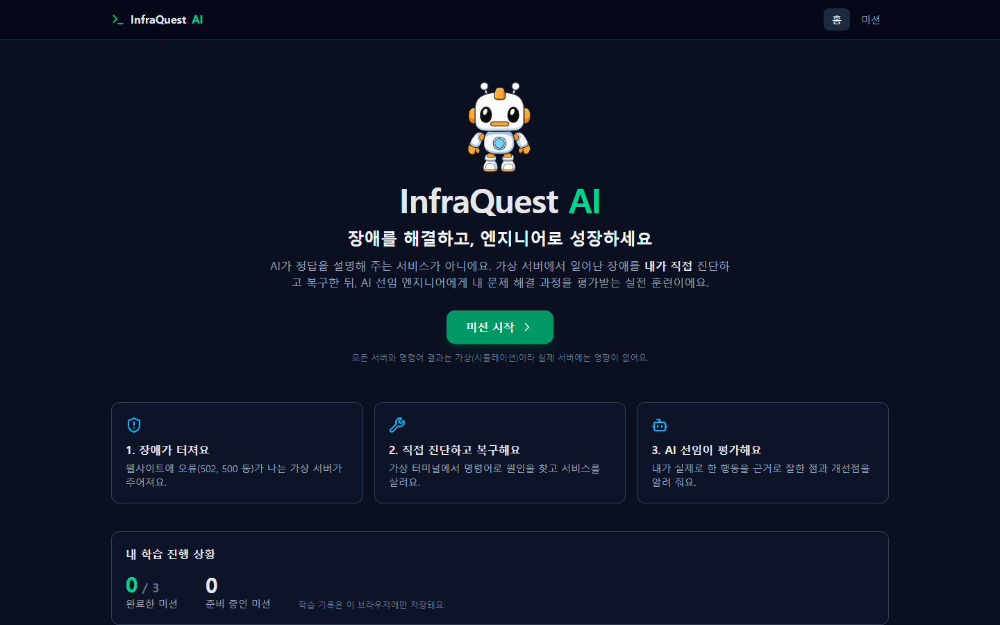
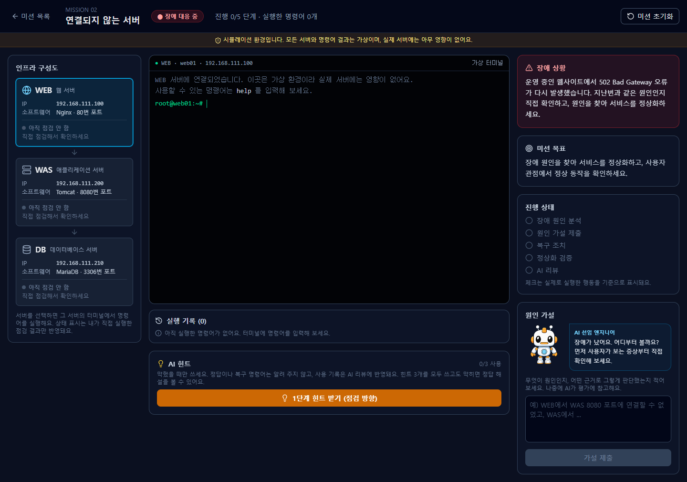
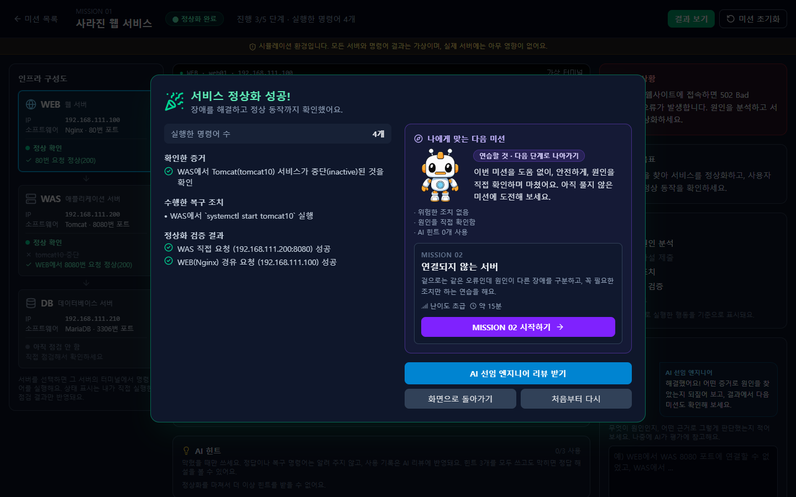
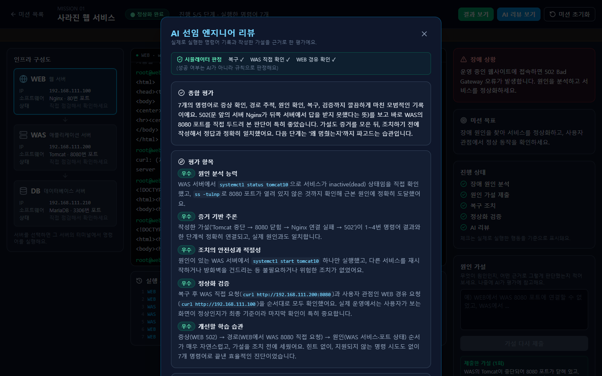

# InfraQuest AI

> 장애를 **설명**해 주는 AI가 아니라, 장애를 **직접 겪게** 하고 내가 푼 과정을 **평가**해 주는 AI 선임 엔지니어

한양여자대학교 AI 해커톤 출품작입니다.

- 저장소: https://github.com/sbiiinnii/InfraQuest-AI
- 배포 주소: https://infraquest-ai.vercel.app
  (처음 접속하거나 한동안 쓰지 않았다면 서버가 깨어나느라 **미션을 열 때 30초~1분** 걸릴 수 있어요.)

<p align="center">
  
</p>

## 소개

InfraQuest AI는 주니어 인프라 엔지니어가 **가상 서버 장애 미션**을 수행하며 스스로 원인을 추론하고, **AI 선임 엔지니어**에게 그 추론 과정을 평가받는 학습 서비스입니다.

- 웹사이트에 502·500 오류가 나는 가상 서버(WEB · WAS · DB 3계층)가 주어집니다.
- 가상 터미널에서 명령어로 증거를 모아 원인을 찾고, 복구하고, 정상화를 **직접 검증**합니다.
- 끝나면 AI가 **내가 실제로 실행한 명령어와 작성한 가설**을 근거로 잘한 점과 개선점을 알려 줍니다.

> 이 서비스의 서버와 명령어 결과는 모두 **가상(시뮬레이션)** 입니다. 실제 서버에는 아무 영향이 없어요.

## 스크린샷

| 미션 화면 | 결과 + 다음 미션 추천 |
|---|---|
|  |  |



## 핵심 기능

| 구분 | 기능 | 설명 |
|---|---|---|
| **필수 (P0)** | **AI 선임 엔지니어 리뷰** | 종합 평가, 5개 항목 등급, 잘한 점·개선할 점(근거 명령어 번호 포함), 선임의 조언 |
| 선택 (P1) | **개인별 다음 미션 추천** | 내 실행 기록의 약한 부분을 찾아 연습할 미션을 추천 (규칙 기반, 버튼으로 바로 시작) |
| 학습 | 미션 3개 | 같은 502인데 원인이 다른 장애, 502가 아니라 500이 나는 장애까지 증상과 원인이 달라요 |
| 학습 | 가상 터미널 | 12종 명령어, 출력은 서버 상태표를 읽어 결정론적으로 생성 |
| 학습 | 서버 상태 카드 | **내가 직접 점검한 결과만** 초록·빨강으로 표시, 조치 후에는 "다시 확인 필요" |
| 학습 | 정상화 검증 | 복구만으로는 끝나지 않고 WAS 직접 요청과 WEB 경유 요청을 모두 확인해야 완료 |
| 학습 | AI 힌트 3단계 | 점검 방향 → 확인할 서버·영역 → 확인용 명령어 (정답·복구 명령어는 알려 주지 않음) |
| 학습 | 정답 해설 | 힌트를 3개 모두 쓴 뒤에만 열림, "해설 보고 푼 미션"으로 기록 |
| 성장 | **캐릭터 육성** | 미션을 정상화하면 경험치(XP)를 얻어 **신입 → 주니어 → 선임** 레벨로 성장하고, 뱃지 5개를 모아요. 해설을 안 보고 풀거나 힌트를 적게 쓰면 경험치를 더 받아요. 규칙으로만 계산하고(AI 미사용) 브라우저에만 저장해요 |
| 안내 | AI 선임 엔지니어 마스코트 | 질문과 격려만 건네는 코치 (정답을 말하지 않음) |

### 미션

| 미션 | 증상 | 원인 |
|---|---|---|
| MISSION 01 — 사라진 웹 서비스 | 웹사이트 502 오류 | (직접 찾아보세요) |
| MISSION 02 — 연결되지 않는 서버 | 또 502 오류 | (지난번과 같을까요?) |
| MISSION 03 — 열렸지만 오류가 나는 웹 | 이번에는 다른 오류 번호 | (오류 번호가 단서예요) |

## AI 활용 방식

**AI가 하는 일과 규칙이 하는 일을 분리**했습니다. 사실(출력, 성공 여부)은 규칙이, 설명과 평가의 질은 AI가 맡습니다.

| 하는 주체 | 일 |
|---|---|
| **규칙 (AI 아님)** | 명령어 출력 생성 · 복구 성공 판정 · 서버 상태 카드 · 정답 해설 · 다음 미션 추천 |
| **AI (Claude 또는 OpenAI)** | 문제 해결 과정 리뷰 · 단계별 힌트 |

**AI 리뷰 (P0)**
- 입력: 실행한 명령어와 출력, 작성한 가설과 제출 시점, 시뮬레이터의 판정 결과, 힌트·해설 사용 기록
- 출력: JSON 스키마로 강제한 구조화 결과 (종합 평가, 원인 분석·증거 추론·조치 안전성·정상화 검증·학습 습관 등급)
- 어느 회사의 AI를 쓸지는 **API 키 모양**으로 자동 정합니다. `sk-ant-`로 시작하면 Claude(기본 `claude-opus-5-5`, 환경변수 `INFRAQUEST_MODEL`), 그 밖의 `sk-` 키는 OpenAI(기본 `gpt-5-mini`, 환경변수 `INFRAQUEST_OPENAI_MODEL`)를 씁니다. 지금 배포된 서비스는 **OpenAI `gpt-5-mini`** 로 동작합니다.

**AI가 틀리거나 지어내지 못하게 하는 장치 (서버가 코드로 검사)**
- AI가 근거로 든 명령어 번호가 실제 실행 기록에 있는지 다시 검사하고, 없는 번호는 제거합니다.
- 복구 성공 여부는 AI가 아니라 규칙이 판정합니다. AI는 판정을 바꿀 수 없습니다.
- 정답 해설을 보고 푼 경우, AI가 뭐라고 쓰든 **원인 분석 등급은 '우수'를 받을 수 없습니다.**
- AI 호출이 실패하면 **가짜 리뷰를 보여 주지 않고** 오류 안내와 다시 시도 버튼만 보여 줍니다.

**AI 힌트**
- 서버가 힌트를 검사해서, 복구 명령어나 원인을 직접 말하면 버리고 다시 만듭니다.
- 3단계 힌트에 든 명령어는 가상 터미널에서 실제로 실행해 보고, **상태를 바꾸는 명령이면** 버립니다.
- 정답(원인·복구 방법)은 브라우저로 보내지 않고, AI에 전달할 때만 서버 안에서 씁니다.

**다음 미션 추천 (P1)**
- 위험한 조치, 해설·힌트 사용, 원인 서버를 직접 확인했는지, 지원하지 않는 명령어 시도, 불필요한 조치를 순서대로 살펴 연습할 미션을 정합니다.
- AI를 쓰지 않아서 같은 기록이면 항상 같은 추천이 나오고, AI 리뷰가 실패해도 추천은 나옵니다.

## 기술 스택

| 영역 | 사용 기술 |
|---|---|
| 프론트엔드 | React 19, Vite 8, Tailwind CSS 4, lucide-react |
| 백엔드 | Python 3.12, FastAPI, Uvicorn, Pydantic |
| AI | Anthropic Claude API (`anthropic` SDK, JSON 스키마 구조화 출력) 또는 OpenAI API (`openai` SDK, JSON 응답) |
| 배포 | 화면: Vercel / 백엔드: Render (`vercel.json`, `render.yaml`) |
| 테스트 | pytest (백엔드 자동 테스트 232개) |

## 실행 방법

필요한 것: **Python 3.12**, **Node.js**, **Claude 또는 OpenAI API 키** (테스트한 환경: Windows 11, Node.js 26)

### Windows (권장)

1. `setup.bat` 을 더블클릭합니다. (패키지 설치 + `backend/.env` 파일 준비)
2. `backend/.env` 파일을 메모장으로 열어 `ANTHROPIC_API_KEY=` 뒤에 본인의 키를 넣고 저장합니다. (OpenAI 키도 같은 칸에 넣으면 됩니다.)
3. `start.bat` 을 더블클릭합니다. 창이 **두 개**(backend, frontend) 열리고, **둘 다 켜 둬야** 합니다.
4. `frontend` 창에 나온 주소(보통 `http://localhost:5173`)를 브라우저로 엽니다.

### 직접 실행 (Windows·macOS·Linux)

```bash
# 1) 백엔드
cd backend
python -m venv .venv
# Windows: .venv\Scripts\activate    macOS/Linux: source .venv/bin/activate
pip install -r requirements.txt
cp .env.example .env        # 열어서 ANTHROPIC_API_KEY= 뒤에 키를 입력
uvicorn main:app --port 8000

# 2) 프론트엔드 (새 터미널)
cd frontend
npm install
npm run dev
```

### 테스트

```bash
cd backend
# Windows: .venv\Scripts\python -m pytest    macOS/Linux: .venv/bin/python -m pytest
python -m pytest
```

> ⚠️ **API 키는 `backend/.env` 에만 넣으세요.** `.env`는 `.gitignore`에 들어 있어 GitHub에 올라가지 않습니다. 키가 코드, 문서, 스크린샷에 보이지 않게 주의하세요. AI 기능(리뷰·힌트)에만 키가 필요하고, 키가 없어도 미션 진행·가상 터미널·서버 상태 카드·정상화 판정·다음 미션 추천은 동작합니다. (정답 해설은 힌트 3개를 모두 써야 열리므로 키가 있어야 합니다.)


## 배포 구성

- **화면(프론트엔드)**: Vercel. 백엔드 주소는 빌드 환경변수 `VITE_API_BASE`로 알려 줍니다.
- **백엔드(FastAPI)**: Render 무료 서비스 1개 (`render.yaml`). 실습 진행 내용을 메모리에 두기 때문에 서버가 **1대로 계속 켜져 있는** 곳이 필요해서 Vercel 함수 대신 Render를 씁니다.
- **서버 환경변수**: `ANTHROPIC_API_KEY`(AI 키), `INFRAQUEST_ALLOWED_ORIGINS`(화면 주소 허용 목록). 키는 호스팅 서비스의 설정 화면에만 넣고 코드나 GitHub에는 넣지 않습니다.

## 구조

```
backend/            Python FastAPI
  engine/             가상 인프라 상태표 · 명령어 해석기 · 판정 · 서버 상태 · 다음 미션 추천 (AI가 관여하지 않음)
  scenarios/          미션 1~3 (초기 장애 상태, 증거 판정 규칙, 정답 해설)
  ai/                 AI 호출(Claude·OpenAI): 리뷰(review.py) · 힌트(hint.py) · 공통(llm.py)
  tests/              자동 테스트
frontend/           React + Vite + Tailwind
  src/pages/          메인 · 미션 목록 · 실습 화면
  src/components/     터미널, 서버 카드, 힌트, 해설, 결과·리뷰 창, 마스코트, 캐릭터 카드
  src/lib/            API 호출 · 학습 기록(progress.js) · 경험치·레벨·뱃지 계산(growth.js)
docs/screenshots/   README용 스크린샷
```

### API

| 메서드 | 경로 | 설명 |
|---|---|---|
| GET | `/api/missions` | 미션 목록 |
| POST | `/api/sessions` | 미션 시작 (실습 세션 생성) |
| GET | `/api/sessions/{sid}` | 현재 실습 상태 |
| POST | `/api/sessions/{sid}/command` | 가상 터미널에 명령어 실행 |
| POST | `/api/sessions/{sid}/hypothesis` | 원인 가설 제출 |
| POST | `/api/sessions/{sid}/hint` | AI 힌트 (최대 3단계) |
| POST | `/api/sessions/{sid}/solution` | 정답 해설 (힌트 3개를 모두 쓴 뒤에만) |
| POST | `/api/sessions/{sid}/review` | AI 리뷰 (미션 완료 후에만) |
| GET | `/api/sessions/{sid}/recommendation` | 다음 미션 추천 (미션 완료 후에만) |
| POST | `/api/sessions/{sid}/reset` | 실습 초기화 |

## 알려진 한계

- 가상 터미널이 지원하는 명령어는 12종입니다. (`systemctl`, `service`, `ss`, `curl`, `journalctl`, `cat`, `tail`, `ufw`, `hostname`, `ip`, `help`, `clear`) 그 밖의 명령어는 "지원하지 않는 명령어"라고 정직하게 알려 줍니다.
- 미션은 **3개**이고 모두 WEB/WAS/DB 서비스 장애 카테고리입니다. **Linux 서버 장애, 네트워크 장애 카테고리는 확장 예정**이며 아직 미션이 없습니다.
- 로그인이 없고 학습 기록은 **브라우저(localStorage)에만** 저장됩니다. 다음 미션 추천은 이번 한 번의 기록과 이 브라우저에서 푼 미션 목록만 참고하며, 여러 번의 기록을 누적 분석하지는 않습니다.
- 실습 진행 내용은 **백엔드 메모리**에 있어서 서버를 껐다 켜면 새로 시작됩니다. (여러 대로 늘리는 구조가 아닙니다)
- 아직 끝내지 못한 사람은 AI 리뷰를 받을 수 없습니다. (정답 해설은 볼 수 있어요)
- AI 리뷰·힌트는 AI가 쓰는 글이라 같은 기록이라도 문장이 매번 조금씩 달라지고, 틀릴 수 있습니다.
- 무료 호스팅이라 한동안 접속이 없으면 서버가 잠들어서 **첫 요청이 30초~1분** 걸릴 수 있습니다.
- 배포된 서비스의 AI 기능은 운영자가 넣은 키로 동작합니다. 그 키를 쓸 수 있는 기간이 끝나면 AI 리뷰·힌트는 오류 안내가 표시되고, 나머지 기능은 그대로 동작합니다.
- 캐릭터 육성 기록(경험치·레벨·뱃지)도 브라우저에만 저장되어 다른 기기에서는 처음부터 시작합니다.
- 라이선스는 아직 정하지 않았습니다.
